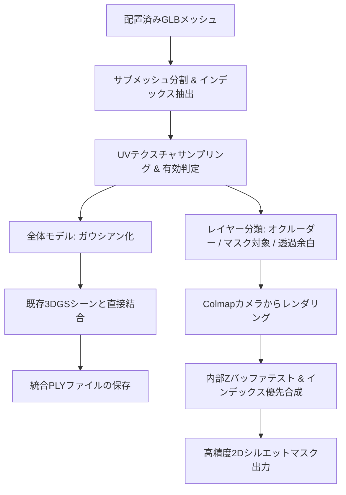

# Mesh2Gaussian.py 使用説明書 (README)

`Mesh2Gaussian.py` は、Blenderなどの3Dソフトウェア上で既存シーンに合わせて配置済みの3Dメッシュ（`.glb` / `.gltf` / `.obj`）を読み込み、**本来のテクスチャ画像を忠実にサンプリングしてガウシアン化し、学習済み3D Gaussian Splatting (3DGS) シーンと直接マージするとともに、インテリジェントなオクルージョン制御を備えた2Dシルエットマスクを自動出力するツール**です。

---

## 1. 開発の背景と特徴

従来の GaussianEditor に備わっているメッシュ追加機能（Wonder3D等のシングルビュー3D生成AIによる生成メッシュをベースにしたパイプライン）をバイパスし、**既に外部で正確に位置合わせ・モデリングされたGLBメッシュを直接シーンへ統合**します。

### 主な特徴

1. **メッシュ本来のテクスチャ（画像）を完全再現**
   - GLBファイル内に格納されている `baseColorTexture`（または画像テクスチャ）とUV座標から、重心座標補間により正確にRGBカラーをサンプリングします。
   - 1つのメッシュオブジェクトに複数マテリアル（Multi-Material）が割り当てられている場合も、マテリアル単位で自動分割してテクスチャを抽出します。

2. **テクスチャ有無に応じたインテリジェントなオクルーダー制御**
   - **全体としてテクスチャを持たないメッシュ（遮蔽物・ボディパーツなど）**:
     オクルーダー（遮蔽壁）として機能します。手前にある場合、奥にあるテクスチャ付きメッシュを遮蔽し、マスク領域から除外（黒）します。
   - **テクスチャを持つメッシュ内の余白・透明領域（デカール等の透明抜き部分）**:
     **オクルーダー遮断を行わず完全透過（スルー）**します。奥にあるテクスチャが不自然に消されることなく、そのままマスクとして描画されます。
   - **テクスチャを持つメッシュの有効テクスチャ領域**:
     手前にある場合にマスク領域（白）として描画されます。

3. **【内部Zバッファ合成方式】によるZ-fightingの完全解消**
   - デカールやステッカーのように「同一平面上に完全に重なるポリゴン」が存在する場合でも、3D座標を物理的にずらす（オフセットする）ことはしません。
   - PyTorch上でレンダリング深度（`depth_3dgs`）を比較し、**メッシュのインデックス番号が大きい方を手前として優先判定**する深度バッファテストを実行します。

4. **座標完全維持＆直接マージ**
   - 回転・移動・スケーリングの変換処理を一切挟みません。Blender等で配置したワールド座標をそのまま保持し、`GaussianModel.concat_gaussians` によって既存の学習済みPLYファイルに直接マージします。

---

## 2. 処理フロー



---

## 3. 動作要件

本スクリプトは `GaussianEditor_RTX5090` の仮想環境上で動作します。

- Python 3.8+
- PyTorch (CUDA対応)
- [trimesh](https://trimesh.org/)
- [Pillow](https://python-pillow.org/)
- 3D Gaussian Splatting / GaussianEditor の各内部モジュール
  - `gaussiansplatting.scene.gaussian_model`
  - `gaussiansplatting.gaussian_renderer`

---

## 4. Blenderでの事前準備・推奨事項

### (1) 位置合わせ
入力するメッシュは、既存シーンの点群やカメラ位置に合わせて、Blender上で位置・回転・スケールを確定（`Ctrl + A` -> `All Transforms` を適用）しておいてください。

### (2) 重なり順（Z-fighting）の制御
同一平面上に重ねて配置するメッシュ（例: 車体の上に貼るステッカーやデカールなど）がある場合、オブジェクト名またはマテリアル名の末尾に優先度数値を付けてください。**数値が大きい方が最前面として優先描画されます**。

- 例:
  - 下地メッシュ（下層）: `BaseBody_01`
  - 重ねるデカール（上層）: `DecalSticker_02`

---

## 5. コマンドライン引数一覧

| 引数名 | 短縮 | 必須 | デフォルト値 | 説明 |
| :--- | :---: | :---: | :---: | :--- |
| `--mesh` | `-m` | **必須** | - | Blender等で配置済みの3Dメッシュファイルパス（`.glb` 推奨、`.gltf`, `.obj`） |
| `--source_path` | `-s` | **必須** | - | Colmapデータセットディレクトリ（`sparse/0/` があるパス） |
| `--model_path` | - | 任意 | `source_path` | 学習済み3DGSモデルの出力先ディレクトリ |
| `--iteration` | - | 任意 | `-1` (最新) | 読み込む学習済みチェックポイントのイテレーション番号 |
| `--output_ply` | `-o` | 任意 | `merged.ply` | 既存シーンと結合した出力先PLYファイル名 |
| `--num_points` | `-n` | 任意 | `200000` | メッシュ表面からサンプリングするガウシアン点数 |
| `--cam_id` | - | 任意 | `0` | 単一マスクをレンダリング保存する基準Colmapカメラ番号 |
| `--save_mask` | - | 任意 | `silhouette_mask.png` | 生成された2Dシルエットマスク（単一視点）の保存先パス |
| `--multiview_mask_dir` | - | 任意 | `None` | 全カメラ視点から2Dマスクを一括出力する保存先フォルダパス |
| `--depth_tolerance` | - | 任意 | `0.005` | 同一平面とみなす深度トレランス（Z-fighting解消用） |

---

## 6. 使用例

### 基本実行（単一視点マスクの生成 ＆ 結合PLYの保存）

```bash
python Mesh2Gaussian.py \
    --mesh "./data/my_aligned_model.glb" \
    --source_path "./dataset/scene_colmap" \
    --model_path "./output/scene_model" \
    --output_ply "./output/scene_model/point_cloud/iteration_30000/merged.ply" \
    --save_mask "./output/masks/mask_cam0.png" \
    --cam_id 0
```

### 全カメラ視点からのマルチビューマスク一括生成

GaussianEditor のセグメンテーションや編集パイプライン（SAM等）でマルチビューマスクを利用する場合、`--multiview_mask_dir` を指定します。

```bash
python Mesh2Gaussian.py \
    --mesh "./data/my_aligned_model.glb" \
    --source_path "./dataset/scene_colmap" \
    --model_path "./output/scene_model" \
    --output_ply "./output/merged_scene.ply" \
    --multiview_mask_dir "./dataset/scene_colmap/multiview_masks"
```

---

## 7. トラブルシューティング

- **デカール等の重なり部分がチラつく／消える場合**:
  - 重ねるメッシュのオブジェクト名末尾にインデックス（`_01`, `_02` など）を付与し、上に来るメッシュの番号を大きくしてください。
  - `--depth_tolerance` の値を調整してください（例: `0.01` など）。
- **テクスチャが真っ暗またはサンプリングされない場合**:
  - メッシュにUV展開が行われているか確認してください（UVが存在しない面はデフォルトカラーが適用されます）。
  - GLBエクスポート時に「マテリアル」および「テクスチャ画像」が埋め込まれていることを確認してください。
