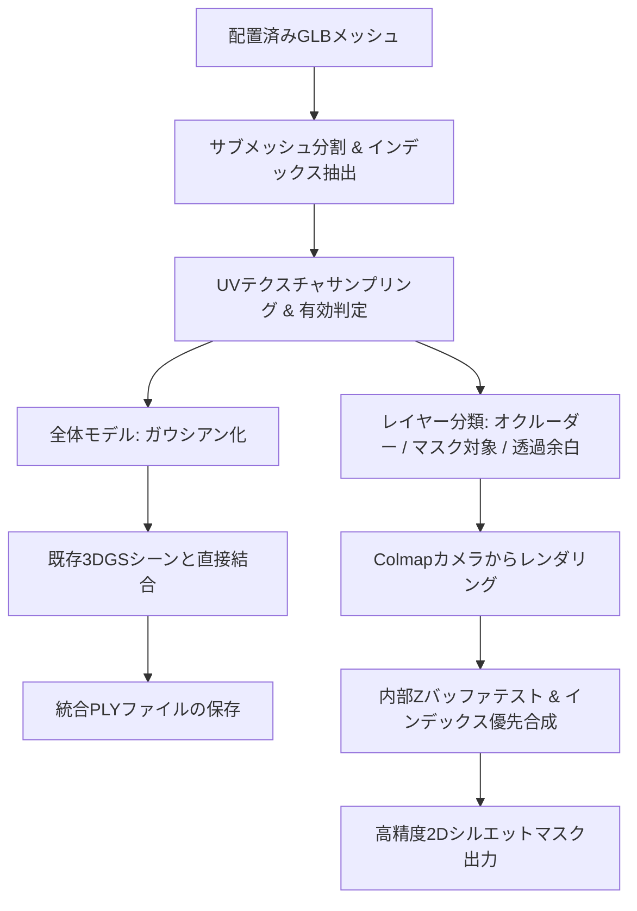

# Mesh2Gaussian.py 使用説明書 (README)

`Mesh2Gaussian.py` は、Blenderなどの3Dソフトウェア上で既存シーンに合わせて配置済みの3Dメッシュ（`.glb` / `.gltf` / `.obj`）を読み込み、**本来のテクスチャ画像を忠実にサンプリングしてガウシアン化し、学習済み3D Gaussian Splatting (3DGS) シーンと直接マージするとともに、インテリジェントなオクルージョン制御を備えた2Dシルエットマスクを自動出力するツール**です。

---

## 1. 開発の背景と特徴

従来の GaussianEditor に備わっているメッシュ追加機能（Wonder3D等のシングルビュー3D生成AIによる生成メッシュをベースにしたパイプライン）をバイパスし、**既に外部で正確に位置合わせ・モデリングされたGLBメッシュを直接シーンへ統合**します。

### 主な特徴

1. **メッシュ本来のテクスチャ（画像）を完全再現**
   - GLBファイル内に格納されている `baseColorTexture`（または画像テクスチャ）とUV座標から、重心座標補間により正確にRGBカラーをサンプリングします。
   - 1つのメッシュオブジェクトに複数マテリアル（Multi-Material）が割り当てられている場合も、マテリアル単位で自動分割してテクスチャを抽出します。

2. **テクスチャ有無に応じたインテリジェントなオクルーダー制御**
   - **全体としてテクスチャを持たないメッシュ（遮蔽物・ボディパーツなど）**:
     オクルーダー（遮蔽壁）として機能します。手前にある場合、奥にあるテクスチャ付きメッシュを遮蔽し、マスク領域から除外（黒）します。
   - **テクスチャを持つメッシュ内の余白・透明領域（デカール等の透明抜き部分）**:
     **オクルーダー遮断を行わず完全透過（スルー）**します。奥にあるテクスチャが不自然に消されることなく、そのままマスクとして描画されます。
   - **テクスチャを持つメッシュの有効テクスチャ領域**:
     手前にある場合にマスク領域（白）として描画されます。

3. **【内部Zバッファ合成方式】によるZ-fightingの完全解消**
   - デカールやステッカーのように「同一平面上に完全に重なるポリゴン」が存在する場合でも、3D座標を物理的にずらす（オフセットする）ことはしません。
   - PyTorch上でレンダリング深度（`depth_3dgs`）を比較し、**メッシュのインデックス番号が大きい方を手前として優先判定**する深度バッファテストを実行します。

4. **座標完全維持＆直接マージ**
   - 回転・移動・スケーリングの変換処理を一切挟みません。Blender等で配置したワールド座標をそのまま保持し、`GaussianModel.concat_gaussians` によって既存の学習済みPLYファイルに直接マージします。

---

## 2. 処理フロー



---

## 3. 動作要件

本スクリプトは `GaussianEditor_RTX5090` の仮想環境上で動作します。

- Python 3.8+
- PyTorch (CUDA対応)
- [trimesh](https://trimesh.org/)
- [Pillow](https://python-pillow.org/)
- 3D Gaussian Splatting / GaussianEditor の各内部モジュール
  - `gaussiansplatting.scene.gaussian_model`
  - `gaussiansplatting.gaussian_renderer`

---

## 4. Blenderでの事前準備・推奨事項

### (1) 位置合わせ
入力するメッシュは、既存シーンの点群やカメラ位置に合わせて、Blender上で位置・回転・スケールを確定（`Ctrl + A` -> `All Transforms` を適用）しておいてください。

### (2) 重なり順（Z-fighting）の制御
同一平面上に重ねて配置するメッシュ（例: 車体の上に貼るステッカーやデカールなど）がある場合、オブジェクト名またはマテリアル名の末尾に優先度数値を付けてください。**数値が大きい方が最前面として優先描画されます**。

- 例:
  - 下地メッシュ（下層）: `BaseBody_01`
  - 重ねるデカール（上層）: `DecalSticker_02`

---

## 5. 推奨ディレクトリ構造 (`Mesh2Gaussian_data`)

入出力データをすべて集約・管理するため、プロジェクト直下に `Mesh2Gaussian_data` フォルダを使用します（スクリプト初回実行時にも自動生成されます）。

```text
GaussianEditor_RTX5090/
├── Mesh2Gaussian.py
├── Readme_Mesh2Gaussian.md
│
└── Mesh2Gaussian_data/                 # 【データ集約フォルダ】
    ├── input/
    │   ├── mesh/                       # ★ここにGLBメッシュを配置 (自動認識)
    │   │   └── my_model.glb
    │   ├── colmap/                     # ★ここにColmapデータセットを配置 (sparse/0/, images/ 等)
    │   │   ├── sparse/0/
    │   │   └── images/
    │   └── model/                      # （任意）既存の学習済み3DGSモデル (point_cloud/)
    │       └── point_cloud/
    │           └── iteration_30000/
    │
    └── output/                         # ★すべての出力がここに自動集約されます
        ├── merged_refined.ply          # 最終PLYファイル (自動生成)
        └── masks/
            ├── mask_cam0.png           # 基準カメラの2Dシルエットマスク (自動生成)
            └── multiview/              # 全カメラ視点の2Dマスク群 (自動生成)
```

---

## 6. 使用例（コマンドライン実行）

### ① 【最短実行】引数なしで一発全自動実行（推奨）

上記の `Mesh2Gaussian_data/input/mesh/` にメッシュを、`input/colmap/` にColmapデータを置いておけば、**コマンドライン引数を一切指定しなくても、すべて全自動で実行**されます。
（不要点群の自動削除・2Dマスク出力・拡散モデル境界最適化がすべてデフォルトで有効です）

```bash
python Mesh2Gaussian.py
```

### ② 入力パスだけを指定して実行

メッシュやColmapデータが別フォルダにある場合、**入力パスだけを指定**すれば、出力先やパラメータは自動的に `Mesh2Gaussian_data/output/` 配下に設定されます。

```bash
python Mesh2Gaussian.py \
    --mesh "C:/path/to/my_aligned_mesh.glb" \
    --source_path "C:/path/to/colmap_dataset"
```

### ③ 拡散モデルによる最適化をスキップして素早く結合したい場合

```bash
python Mesh2Gaussian.py --no_refine
```

---

## 7. コマンドライン引数一覧

すべての引数はデフォルト値が設定されているため、特別なカスタマイズが必要な場合のみ指定してください。

| 引数名 | 短縮 | デフォルト値 | 説明 |
| :--- | :---: | :---: | :--- |
| `--data_dir` | - | `Mesh2Gaussian_data` | 入出力を集約する基準フォルダパス |
| `--mesh` | `-m` | 自動検出 | 配置済み3Dメッシュファイル（未指定時は `data_dir/input/mesh/` から自動検出） |
| `--source_path` | `-s` | `data_dir/input/colmap` | Colmapデータセットディレクトリ |
| `--model_path` | - | `source_path` | 学習済み3DGSモデルディレクトリ |
| `--iteration` | - | `-1` (最新) | 読み込む学習済みチェックポイント番号 |
| `--output_ply` | `-o` | `data_dir/output/merged_refined.ply` | 最終結合PLYファイルの保存先 |
| `--save_mask` | - | `data_dir/output/masks/mask_cam0.png` | 基準カメラの2Dマスク保存先 |
| `--multiview_mask_dir` | - | `data_dir/output/masks/multiview` | 全カメラ2Dマスク一括保存先フォルダ（デフォルト有効） |
| `--no_multiview` | - | `False` (全視点マスク生成有効) | 全カメラ視点の2Dマスク一括生成を無効化するフラグ |
| `--no_prune` | - | `False` (自動削除有効) | 重複する不要ガウシアンの自動くり抜きを無効化するフラグ |
| `--rotate_x` | - | `180.0` | X軸周りの回転補正角度 (度)。COLMAP系とglTF系の食い違いを解消するためデフォルトで180度有効 |
| `--rotate_y` | - | `0.0` | Y軸周りの回転補正角度 (度) |
| `--rotate_z` | - | `0.0` | Z軸周りの回転補正角度 (度) |
| `--no_rotate_x` | - | `False` (X軸180°補正有効) | X軸180度回転補正を無効化するフラグ |
| `--no_refine` | - | `False` (最適化有効) | 拡散モデルによる境界ブレンディングを無効化するフラグ |
| `--prompt` | - | `a photorealistic...` | 境界ブレンディング最適化のプロンプト |
| `--refine_steps` | - | `200` | 最適化ステップ数 |

---

## 8. トラブルシューティング

- **3Dメッシュの向き・上下反転（180度回転）について**:
  - COLMAP/3DGSの生座標系（+Yが下）とglTF規格（+Yが上）の差異を自動解消するため、`Mesh2Gaussian.py` は**デフォルトでX軸180度回転補正（`--rotate_x 180.0`）を自動適用**します。
  - 特殊な座標系でエクスポートされたメッシュ等で回転が不要な場合は、`--no_rotate_x` を指定することで回転補正を無効化できます。
- **デカール等の重なり部分がチラつく／消える場合**:
  - 重ねるメッシュのオブジェクト名末尾にインデックス（`_01`, `_02` など）を付与し、上に来るメッシュの番号を大きくしてください。
  - `--depth_tolerance` の値を調整してください（例: `0.01` など）。
- **テクスチャが真っ暗またはサンプリングされない場合**:
  - メッシュにUV展開が行われているか確認してください（UVが存在しない面はデフォルトカラーが適用されます）。
  - GLBエクスポート時に「マテリアル」および「テクスチャ画像」が埋め込まれていることを確認してください。


